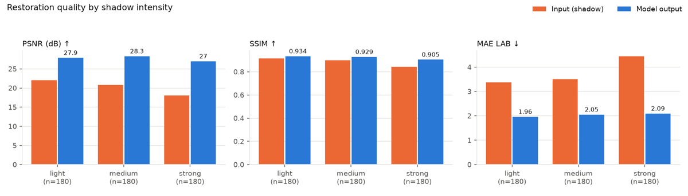
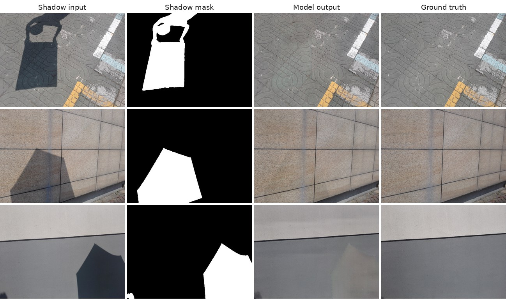
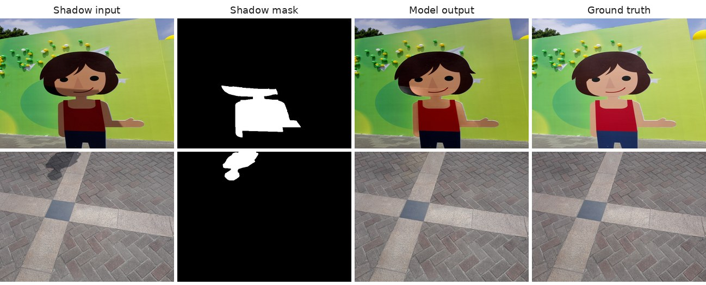

# Mask-Guided Shadow Removal for Natural Scene Images

A U-Net encoder-decoder that takes an RGB image together with its shadow mask and removes the shadow. The mask gates the skip connections, so the network restores the shadow region while keeping the scene's structure and texture. A small detector branch predicts the mask when none is given.

- **Dataset**: ISTD. 1,330 training triplets, split by scene into training and validation; 540 test triplets.
- **Model**: a 4-level U-Net (64→512 channels) with mask-guided attention on the skips and a residual output, plus a 32-channel detector U-Net.
- **Loss**: L1 + shadow-region L1 + SSIM + gradient + VGG perceptual, and BCE + Dice for the detector.
- **Metrics**: PSNR, SSIM and MAE (LAB and RGB) on the whole image, the shadow region and the non-shadow region, also broken down by shadow intensity and scene condition.

## Results (ISTD test set, 540 images)

| Region | PSNR ↑ | SSIM ↑ | MAE LAB ↓ |
|---|---|---|---|
| Whole image | 20.33 → **27.72** | 0.885 → **0.922** | 3.78 → **2.04** |
| Shadow region | 13.35 → **26.66** | 0.661 → **0.867** | 11.11 → **2.96** |
| Non-shadow region | 25.67 → **28.25** | 0.921 → **0.930** | 2.54 → **1.90** |

Each cell shows the shadowed input → the model output, using ground-truth masks. Inference takes 17 ms per 640×480 image.

**Without a mask**, using the detector's own predicted mask, the model scores 25.92 dB PSNR, 0.915 SSIM and 2.38 MAE LAB on the whole image. The detector scores 5.51% BER, 0.79 IoU and 0.85 F1.

### By shadow intensity and scene condition

| Condition | Bin | PSNR (input → output) | Shadow-region PSNR |
|---|---|---|---|
| Shadow intensity | light / medium / strong | 22.05 → 27.89 / 20.83 → 28.29 / 18.09 → 26.97 | 27.66 / 27.81 / 24.52 |
| Shadow area | small / medium / large | 23.29 → 28.20 / 20.42 → 28.25 / 17.27 → 26.70 | 26.34 / 26.93 / 26.73 |
| Scene brightness | dark / medium / bright | 20.46 → 25.06 / 20.47 → 29.60 / 20.04 → 28.48 | 23.05 / 28.82 / 28.12 |
| Scene texture | smooth / medium / textured | 19.87 → 26.50 / 21.50 → 30.21 / 19.61 → 26.44 | 25.86 / 28.66 / 25.47 |

Each bin is one third of the test set (180 images). The biggest gains are on strong and large shadows. Strong shadows and dark scenes are still the hardest cases, with shadow-region PSNR about 3–5 dB below the other bins.



## Samples



**Best and worst test images.** Top row: the worst case, 129-3 at 16.5 dB. The shadow is removed, but the ground truth of ISTD scene 129 has a different overall colour from its input, so the score is low. This is a known colour inconsistency in ISTD. Bottom row: the best case, 103-9 at 37.5 dB.



## Usage

```bash
bash setup_env.sh cu121 --data-dir /mnt/shadow                    # environment (pinned torch 2.5.1)
bash scripts/download_istd.sh --data-dir /mnt/shadow              # ISTD dataset
python train.py --data-dir /mnt/shadow --gpu 0                    # train + validate, then test
python test.py  --data-dir /mnt/shadow --gpu 0 --checkpoint outputs/<run>/checkpoints/best.pth
python infer.py --data-dir /mnt/shadow --gpu 0 --checkpoint <ckpt> --input photo.jpg   # mask optional
python webapp/server.py --data-dir /mnt/shadow --gpu 0 --checkpoint <ckpt>             # web UI
```

Everything (dataset, checkpoints, results) is written under `--data-dir`. Settings are in [configs/istd.yaml](configs/istd.yaml). There is also a Colab notebook: [Shadow_Removal_Colab.ipynb](Shadow_Removal_Colab.ipynb).

## References

- Wang, Li, Yang. *Stacked Conditional GANs for Jointly Learning Shadow Detection and Shadow Removal* (ISTD), CVPR 2018.
- Ronneberger et al. *U-Net*, MICCAI 2015.
